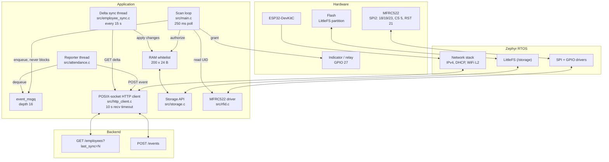
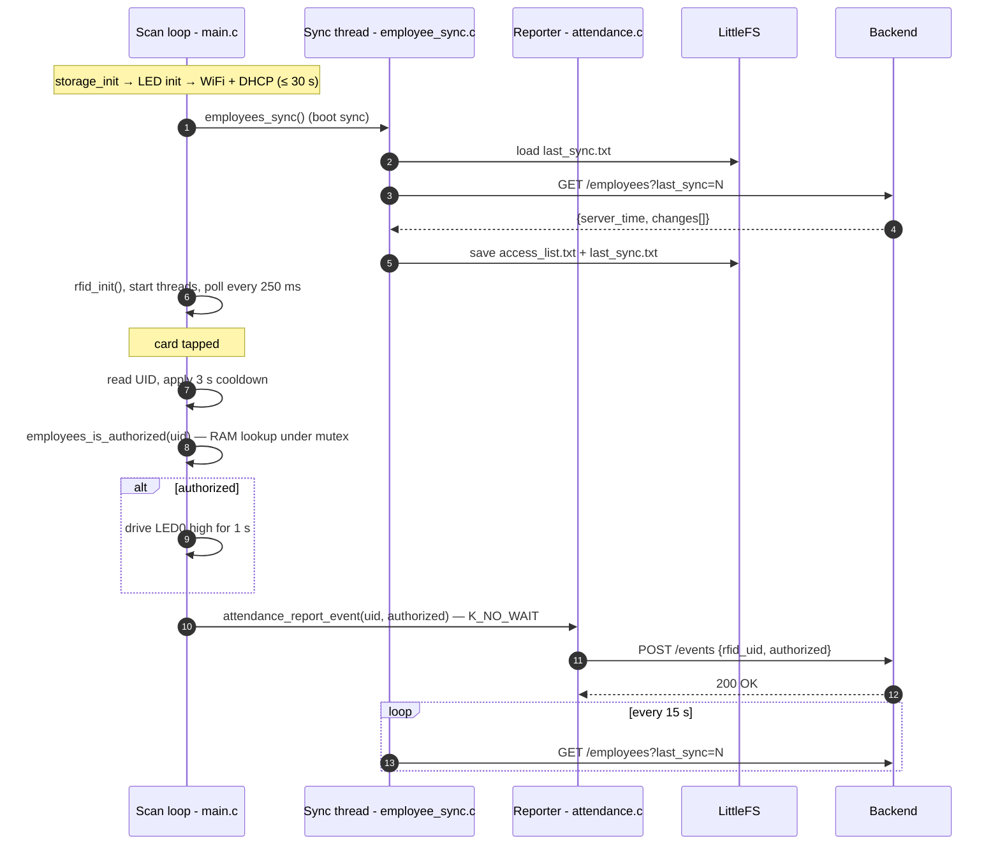

# TapGate

Firmware for an RFID **access-control and attendance terminal**, built on **Zephyr RTOS** for the **ESP32-DevKitC**.

Tap a card and the device decides on the spot: the UID is checked against a whitelist mirrored in RAM (backed by LittleFS on flash), an indicator is driven to grant access, and the scan is reported to a central backend over WiFi. The employee list delta-syncs from that backend, so the terminal keeps working when the network — or the server — is down.

> **Status:** internship/portfolio project, hardware-verified on an ESP32-DevKitC + MFRC522. Plain HTTP (no TLS), no OTA, no test suite. See [Limitations](#limitations).

---

## Table of contents

1. [What it does](#what-it-does)
2. [Hardware & wiring](#hardware--wiring)
3. [Architecture](#architecture)
4. [Boot & card-scan flow](#boot--card-scan-flow)
5. [Design notes](#design-notes)
6. [Flash layout](#flash-layout)
7. [Backend API](#backend-api)
8. [Repository layout](#repository-layout)
9. [Build & flash](#build--flash)
10. [Mock backend](#mock-backend)
11. [Configuration reference](#configuration-reference)
12. [Troubleshooting](#troubleshooting)
13. [Limitations](#limitations)
14. [License](#license)

---

## What it does

- **Local authorization, no round-trip.** Up to 200 UIDs are mirrored in RAM (`whitelist[200][24]`); a tap is a 200-entry linear scan, with no network in the path.
- **Works offline.** The whitelist persists to `/storage/access_list.txt`, so the terminal keeps granting and denying access across network outages and power cycles.
- **Delta sync.** Every 15 s it asks the server `GET /employees?last_sync=<cursor>` and applies only the changes since its stored cursor.
- **Non-blocking reporting.** Scans are pushed into a Zephyr message queue and posted by a dedicated thread, so a slow or dead server never stalls the scan loop.
- **Debounced reads.** Holding a card against the reader produces one event, not one per poll (3 s cooldown per UID).
- **Bounded failure modes.** 10 s socket receive timeout, 30 s DHCP wait, bounded HTTP buffers, and a queue that drops instead of blocking.

## Hardware & wiring

Target board: `esp32_devkitc_procpu` (ESP32-DevKitC). Everything is declared in [`boards/esp32_devkitc_procpu.overlay`](boards/esp32_devkitc_procpu.overlay).

**MFRC522 RFID reader on SPI2:**

| MFRC522 pin | ESP32 GPIO | Note |
| :--- | :--- | :--- |
| SCLK | GPIO 18 | `SPIM2_SCLK` |
| MISO | GPIO 19 | `SPIM2_MISO` |
| MOSI | GPIO 23 | `SPIM2_MOSI` |
| SDA / CS | GPIO 5 | active-low chip select |
| RST | GPIO 21 | active-low hardware reset |
| 3.3V | 3.3V | **do not use 5 V** |
| GND | GND | common ground |

**Access-granted indicator:**

| Signal | ESP32 GPIO | Note |
| :--- | :--- | :--- |
| `led0` (LED / relay input) | GPIO 27 | active-high, driven for 1 s on granted access |

> If you drive a relay instead of an LED, keep its polarity in mind — `gpio_pin_set_dt(&led, 1)` drives the pin **high**. Relay boards are often active-low, in which case move the pin to a low-driven state or invert the overlay. The pin and active level are set in the overlay; the 1 s pulse is in [`src/main.c`](src/main.c).

## Architecture



## Boot & card-scan flow



**Boot sequence, in order** ([`src/main.c`](src/main.c)):

1. Mount LittleFS at `/storage`.
2. Print any leftover boot-diagnostic file.
3. Configure the indicator LED.
4. Join WiFi and block up to 30 s for DHCP.
5. Initial `employees_sync()` — on failure it logs a warning and continues on the cached whitelist.
6. `rfid_init()` — MFRC522 self-test; a failure is logged but the scan loop still runs (the driver retries reads).
7. Start the reporter thread and the periodic sync thread (15 s).
8. Enter the scan loop: poll for a card every 250 ms.

## Design notes

### `event_msgq` — the scan loop never waits on the network

[`src/attendance.c`](src/attendance.c) defines `K_MSGQ_DEFINE(event_msgq, ..., 16, 4)`. The scan loop enqueues with `K_NO_WAIT`; the reporter thread blocks in `k_msgq_get(..., K_FOREVER)`, so it costs nothing while idle.

Consequence, stated plainly: **if the queue fills (16 events, e.g. server unreachable for a while) new events are dropped and logged — not retried.** That is a deliberate trade: a stuck scanning terminal is worse than a lost attendance record. If you need durability, persist the queue to flash first.

### `whitelist_mutex` — network I/O stays outside the lock

The scan loop (`employees_is_authorized()`) and the sync thread (`employees_sync()`) both touch `whitelist[]`/`whitelist_len`. The mutex is held only for the RAM merge and the LittleFS write — the HTTP GET happens **before** taking it, so an unreachable server can never block a tap.

The whitelist loads lazily: the first authorization check triggers `whitelist_load_locked()` if it hasn't happened yet.

### `ip_obtained_sem` — DHCP without polling

[`src/wifi.c`](src/wifi.c) starts a `K_SEM_DEFINE(ip_obtained_sem, 0, 1)`. The boot thread waits on it for up to 30 s; the `NET_EVENT_IPV4_ADDR_ADD` callback gives it, unblocking boot the instant DHCP completes.

### LittleFS truncation

`FS_O_WRITE` overwrites from offset 0 but does **not** truncate. When the whitelist shrinks (an employee is removed), the old trailing bytes would survive and be re-read on the next boot as phantom UIDs. [`src/storage.c`](src/storage.c) calls `fs_truncate(&file, 0)` before every write.

### Timestamp delta sync

The device never trusts its own clock (the ESP32 has no RTC). It sends its stored cursor and adopts the `server_time` the server returns as the new cursor, so drift and reboots don't break the delta. Batches are capped at 32 changes; a full batch triggers an immediate follow-up request so a large backlog drains without waiting for the next period.

### Cooldown & debounce

[`src/main.c`](src/main.c) ignores repeat reads of the same UID within `CARD_COOLDOWN_MS` (3000 ms), so holding a card on the reader logs one event rather than one every 250 ms.

## Flash layout

LittleFS partition mounted at `/storage`:

```
/storage
├── access_list.txt   # authorized UIDs, one per line ("04A1B2C3\n05B2C3D4\n")
└── last_sync.txt     # server UNIX timestamp cursor — the delta-sync position
```

The firmware also *reads* `last_api_response.txt` at boot and prints it if present. That file is a leftover from an earlier HTTP demo; nothing in the current flow writes it.

## Backend API

The server address lives in [`src/server_config.h`](src/server_config.h) — currently `192.168.1.246:8000`, a LAN address. Both endpoints are plain HTTP.

### `GET /employees?last_sync=<unixts>`

Returns the changes since the device's cursor. `last_sync=0` on first boot.

```json
{
  "server_time": 1715000900,
  "changes": [
    { "rfid_uid": "04A1B2C3", "updated_at": 1715000850, "deleted": false },
    { "rfid_uid": "11223344", "updated_at": 1715000860, "deleted": true }
  ]
}
```

- At most **32** changes are parsed per response; a shorter batch means "caught up".
- `deleted: true` removes the UID from local access.
- `server_time` becomes the next cursor.

### `POST /events`

```json
{ "rfid_uid": "04A1B2C3", "authorized": true }
```

`Content-Type: application/json`. Denied taps are reported too, with `authorized: false`. A non-2xx or timeout is logged and the event is dropped.

### `GET /health`

Only used by the mock backend below; the firmware doesn't call it.

## Repository layout

```
.
├── boards/
│   └── esp32_devkitc_procpu.overlay   MFRC522 SPI2, reset pin, LED
├── mock_backend/
│   └── server.py                      run the device against a laptop
├── src/
│   ├── main.c                         boot, scan loop, cooldown, indicator
│   ├── employee_sync.c/.h             whitelist RAM mirror, delta sync thread
│   ├── attendance.c/.h                event queue + reporter thread
│   ├── rfid.c/.h                      MFRC522 driver over SPI2
│   ├── storage.c/.h                   LittleFS mount and file API
│   ├── http_client.c/.h               POSIX-socket HTTP GET/POST
│   ├── wifi.c/.h                      WiFi + DHCP connection handling
│   └── server_config.h                backend host/port
├── CMakeLists.txt
├── Kconfig
├── prj.conf                           committed Zephyr config
├── prj.local.conf.example             copy → prj.local.conf (git-ignored)
└── README.md
```

## Build & flash

### Prerequisites

- A Zephyr workspace with the **ESP32 HAL modules** (`west init` + `west update`), and the **Zephyr SDK** with the `xtensa-espressif_esp32_zephyr-elf` toolchain.
- `west`, CMake, Ninja, Python 3 (all part of the Zephyr getting-started setup).

This repository is a **standalone Zephyr application** — copy/clone it into an existing workspace's application directory (or add it as `west build` source). `west build -b esp32_devkitc_procpu` will not run on a machine without the ESP32 modules.

### 1. Set WiFi credentials

They are deliberately **not** in `prj.conf`:

```bash
cp prj.local.conf.example prj.local.conf
# edit prj.local.conf
```

Build with the file merged in:

```bash
west build -b esp32_devkitc_procpu -- -DEXTRA_CONF_FILE=prj.local.conf
```

<sub>Zephyr &lt; 3.4 uses `-DOVERLAY_CONFIG=prj.local.conf` instead of `EXTRA_CONF_FILE`.</sub>

With no credentials the firmware logs a clear error and exits instead of silently failing to connect.

### 2. Set the backend address

Edit [`src/server_config.h`](src/server_config.h):

```c
#define APP_SERVER_HOST "192.168.1.246"
#define APP_SERVER_PORT "8000"
```

### 3. Build, flash, monitor

```bash
west build -b esp32_devkitc_procpu -- -DEXTRA_CONF_FILE=prj.local.conf
west flash
west espressif monitor
```

## Mock backend

So a clone can be tested end-to-end without the production server:

```bash
python3 mock_backend/server.py --port 8000
```

It prints the LAN IP to use. Point `APP_SERVER_HOST` at it, flash, and:

- first sync returns three seeded UIDs → taps with those UIDs are granted;
- any other card is denied but still reported;
- every event is appended to `mock_backend/events.jsonl`.

Verify it by hand:

```bash
curl "http://localhost:8000/employees?last_sync=0"
curl -X POST localhost:8000/events -H 'Content-Type: application/json' \
     -d '{"rfid_uid":"04A1B2C3","authorized":true}'
```

## Configuration reference

| Setting | Where | Default |
| :--- | :--- | :--- |
| WiFi SSID / PSK | `prj.local.conf` (git-ignored) | empty — must be set |
| Backend host / port | `src/server_config.h` | `192.168.1.246:8000` |
| Sync interval | `employees_sync_start_periodic(15)` in `src/main.c` | 15 s |
| Card cooldown | `CARD_COOLDOWN_MS` in `src/main.c` | 3000 ms |
| Whitelist capacity | `MAX_UIDS` in `src/employee_sync.c` | 200 |
| Max changes per sync | `MAX_CHANGES` in `src/employee_sync.c` | 32 |
| Event queue depth | `EVENT_QUEUE_DEPTH` in `src/attendance.c` | 16 |
| HTTP receive timeout | `HTTP_RECV_TIMEOUT_SEC` in `src/http_client.c` | 10 s |
| DHCP wait | `k_sem_take(..., K_SECONDS(30))` in `src/wifi.c` | 30 s |
| Indicator pin / polarity | `boards/esp32_devkitc_procpu.overlay` | GPIO 27, active-high |

## Troubleshooting

| Symptom | Likely cause |
| :--- | :--- |
| `No WiFi credentials configured` | `prj.local.conf` missing or not passed via `-DEXTRA_CONF_FILE` |
| `Timeout waiting for IP address` | Wrong SSID/PSK, 5 GHz-only network (the ESP32 is 2.4 GHz), or weak signal |
| `Failed to initialize MFRC522` | SPI wiring, CS/RST pins, or 5 V power on the MFRC522 |
| Card read but always denied | Whitelist empty: sync failed, or the UID format from the server differs from the local hex string |
| Sync fails every 15 s | Backend unreachable, `APP_SERVER_HOST/PORT` wrong, or device not on the same LAN |
| No events on the server | Firewall on the backend host, or the server expects TLS (this client is plain HTTP) |
| Build: unknown board | ESP32 HAL modules not in the workspace — run `west update` |
| Weird/duplicate UIDs after deleting employees | Should be impossible now that `fs_truncate` runs before every write; if seen, flash was written by older firmware |

## Limitations

- **No TLS.** Credentials and attendance data cross the LAN in clear text; unsuitable as-is for untrusted networks.
- **No event durability.** Events dropped from a full queue or failing `POST` are lost, not retried.
- **200 UID ceiling** for the local whitelist, 24 bytes per UID.
- **No RTC.** Wall-clock time comes only from the server.
- **Plain-text whitelist** on flash; no encryption or signing.
- **No OTA update path** — flashing is via USB.
- **No automated tests**; verification is hardware-in-the-loop.

## License

No license file has been added to this repository yet. Until one is chosen, the code is all-rights-reserved by its author. If you intend to publish or reuse it, pick one (MIT and Apache-2.0 are the usual choices for firmware like this) and add a `LICENSE` file.
